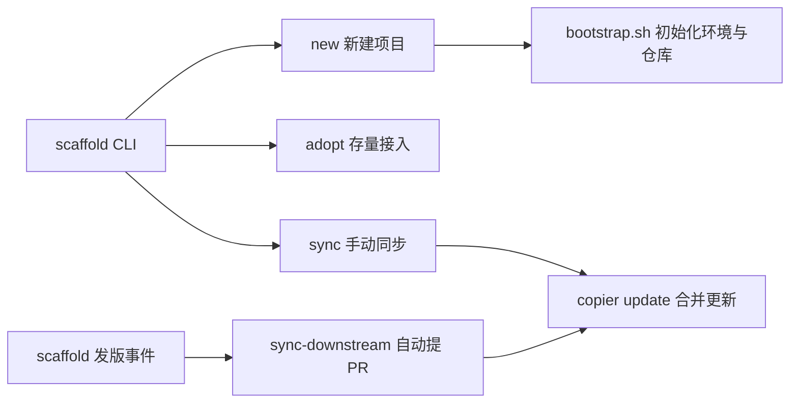

# scaffold

面向 Taitide 工程体系的统一项目脚手架与治理同步命令行工具，基于 Copier 驱动项目初始化、存量仓库接入与下游基建自动同步。

## 背景

跨语言、跨可见性的仓库往往需要同步维护工具链版本、`hk` 门禁、安全扫描与发版流水线。`scaffold` 将治理策略与语言模板收口到单一真源仓库，避免复制粘贴导致的配置漂移。



## 安装与使用

前置条件：本机已安装 `mise` 与 `uv`；如需自动创建 GitHub 仓库与规则集，需先登录 `gh`。

直接使用 `bunx` 按技术栈子命令创建新项目：

```sh
bunx @taitide/scaffold new rust my-service
```

非交互式创建示例：

```sh
bunx @taitide/scaffold new rust my-service \
  --defaults \
  --kind workspace \
  --visibility public \
  --create-remote
```

本地克隆本仓库后开发调试：

```sh
mise install
mise x -- bun install --frozen-lockfile
mise run build
mise run check
```

## 命令与参数矩阵

`scaffold new <stack> <dir>` 与 `scaffold adopt <stack> [dir]` 统一通过第一级子命令 `<stack>` 选择 `base`、`rust`、`uv` 或 `bun`，各子命令仅暴露该技术栈合法的参数。

### 通用选项

| 参数         | 命令行选项        | 可选值与默认值                              | 说明                                         |
| :----------- | :---------------- | :------------------------------------------ | :------------------------------------------- |
| 项目标识     | `--name`          | 匹配 `^[a-z][a-z0-9-]*$`                    | 指定 `--defaults` 时默认取目录名             |
| 项目描述     | `--description`   | 默认 `A Taitide project.`                   | 写入清单与文档概览                           |
| 仓库可见性   | `--visibility`    | `public`、`private`，默认 `public`          | 控制开源治理文件、CodeQL 与自动合并          |
| GitHub 组织  | `--org`           | 默认公开 `taitide-labs`、私有 `taitide-inc` | 用于远端仓库创建与文档链接                   |
| 模板来源     | `--template`      | 默认 `gh:taitide-labs/scaffold`             | 支持本地目录或 Git 仓库地址                  |
| 非交互默认值 | `--defaults`      | 默认关闭                                    | 对未指定选项应用模板默认值                   |
| 创建远端仓库 | `--create-remote` | 默认关闭                                    | 仅 `new` 支持，自动建库、配规则并提交首个 PR |

### 各技术栈专有选项

| 子命令 | 专有选项                         | 说明                                                                                             |
| :----- | :------------------------------- | :----------------------------------------------------------------------------------------------- |
| `base` | 无                               | 仅含通用治理、文档与 CI 基线，禁止传入 `--kind` 或 `--publish-registries`                        |
| `rust` | `--kind`、`--publish-registries` | `--kind` 可选 `workspace` 或 `cli`；`--publish-registries` 仅 `--kind cli` 且非 `private` 时可用 |
| `uv`   | `--publish-registries`           | 非 `private` 时可启用 PyPI 发布                                                                  |
| `bun`  | `--publish-registries`           | 非 `private` 时可启用 npm 发布                                                                   |

## 存量迁移与下游同步

### 存量仓库接入

在已有项目根目录运行 `adopt`，可跳过初始化脚本并以非破坏方式覆盖治理配置、生成 `.copier-answers.yml`：

```sh
bunx @taitide/scaffold adopt uv . --defaults --visibility private
```

### 下游仓库同步

当上游模板发布新版本后，维护者可在任意已接入仓库本地执行同步：

```sh
bunx @taitide/scaffold sync
```

同时，每次 `taitide-labs/scaffold` 发布正式 Release 时，`.github/workflows/sync-downstream.yml` 会自动扫描组织内未归档且 `.copier-answers.yml` 指向 `scaffold` 的仓库，执行 `copier update --trust --defaults --conflict=rej --quiet`。若无冲突则自动推送 `chore/sync-scaffold` 分支并创建 Pull Request；若产生 `.rej` 冲突文件则跳过该仓库交由人工处理。也可通过 GitHub Actions 的 `workflow_dispatch` 手动指定仓库列表触发。

## 发布冷启动配置

`scaffold` 自身及生成项目的自动发版流水线依赖 GitHub App 与各包管理平台的 OIDC 信任发布机制，零长期密钥存储。

1. 在仓库或组织 Secrets 中配置 GitHub App 凭证 `RELEASE_APP_CLIENT_ID` 与 `RELEASE_APP_PRIVATE_KEY`；该 App 需具备 `contents: write` 与 `pull-requests: write` 权限，使 `release-please` 与 `upload-assets` 释放草稿版本后能够顺利触发下游 `sync-downstream` 流水线。
2. 如启用 Rust CLI 的 Homebrew Tap 自动更新，另需配置具备目标 Tap 仓库写权限的 `HOMEBREW_TAP_TOKEN`。
3. 首次启用公开包发布前，需在对应注册表完成冷启动绑定：
   - npm：若包尚未存在，先使用一次性发布或人工创建占位包，再在 npmjs.com 包设置中添加 GitHub Actions Trusted Publisher，绑定组织、仓库与 `release.yml`。
   - PyPI：在 pypi.org 的 Publishing 页面配置 Pending Publisher，填写包名、GitHub 组织、仓库与 `release.yml`。
   - crates.io：先手工执行一次 `cargo publish` 创建 crate，随后在 crates.io 包设置中添加 GitHub Actions Trusted Publishing 规则，绑定仓库与 `release.yml`。

## 贡献

详见 [CONTRIBUTING.md](CONTRIBUTING.md) 与 [SECURITY.md](SECURITY.md)。

## 许可证

[MIT](LICENSE) © 2026 Taitide Labs
